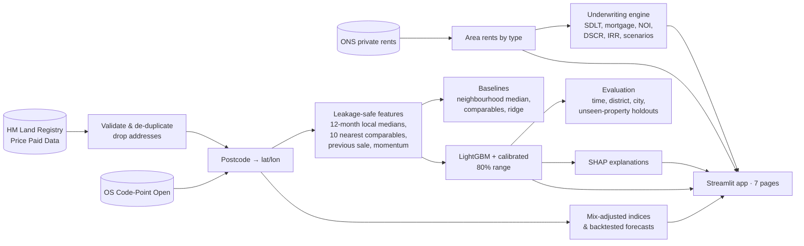

# AI Real Estate Investment & Property Valuation Intelligence

**Value homes, find rental opportunities, underwrite deals and stress-test them, using real UK open data.**


Investors usually work across scattered listings, spreadsheets and gut feel. This platform brings it into one
place: it values a property from recent local sales and shows the comparables and reasons behind the estimate. It
ranks candidate purchases by cash flow, yield and risk, and runs a full buy-to-let underwriting model with editable
scenarios. The intended production build uses public records; the included tests use explicitly labeled invented fixture rows. Real-data metrics require a successful local build.

> **Data:** HM Land Registry Price Paid Data, ONS Price Index of Private Rents and OS Code-Point Open, all under the
> Open Government Licence v3.0. Targets 12 English cities after the external datasets are downloaded and processed. Currency: GBP (£).
> **Not investment advice.** Estimates are for research and decision support.

---

## Results

<!-- RESULTS:START -->
_Run `python scripts/build_data.py` and then `python scripts/make_report.py` to fill in this section from the
real test results._
<!-- RESULTS:END -->

Full tables by city, property type, price tier and evidence quality: [docs/results.md](docs/results.md).

## The seven-page application

| | Page | What it is for |
|---|---|---|
| 01 | **Executive Market Overview** | Prices, rents, gross yields and sales volume by city; mix-adjusted price trends; data-quality log |
| 02 | **AI Valuation Engine** | Value any postcode, type and tenure: estimate, 80% range, 10 comparables on a map, the drivers behind the number, warnings |
| 03 | **Opportunity Finder** | Rank recent sales as if offered at their price, by cash-on-cash, price vs estimate, DSCR and risk flags |
| 04 | **Rental Yield & Cash Flow** | Yield heatmap by city and type; a full deal calculator with SDLT, mortgage, NOI, DSCR and IRR |
| 05 | **Geospatial Intelligence** | Postcode-sector map of price, growth, yield and valuation accuracy, with sample-size caveats |
| 06 | **Forecasting & Risk** | Price and rent forecasts with backtested ranges, always compared with "no change"; equity stress test |
| 07 | **Scenario Simulator** | Editable base, upside and downside cases; cash flow by year; IRR sensitivity; JSON/CSV export |

| | |
|---|---|
|  |  |
|  |  |

## How it works



**No look-ahead.** A sale in month *m* is valued only with sales completed up to month *m − 2* (a month of
publication lag), over a trailing 12 months. A test proves it: it corrupts the prices of the month being valued and
deletes every later sale, then checks that the features do not change.

**Honest validation.** Four views of accuracy, all reported:

* **Temporal holdout:** train on earlier months, tune on the next three, test on the latest six.
* **Unseen properties:** the same test restricted to homes that never appeared in training.
* **Geographic holdout:** about 20% of postcode districts removed from training entirely.
* **Leave-one-city-out:** each city valued by a model trained only on the others.

**Intervals that mean what they say.** Quantile models give a raw 80% range, which is then widened by conformal
calibration on validation months so that about 80% of real prices land inside it.

**Underwriting you can audit.** Every formula is written out in
[`underwriting.py`](src/reintel/finance/underwriting.py) and checked by hand-worked tests, including the 0%
mortgage-rate and all-cash cases.

## Quick start

```bash
git clone <this-repo> && cd ai-real-estate-investment-intelligence
python -m venv .venv && source .venv/bin/activate        # Windows: .venv\Scripts\activate
pip install -r requirements-dev.txt

# 1. download the public files into data/raw/ (links in data/raw/README.md)
python scripts/build_data.py        # validate, geocode, train, evaluate (a few minutes)
python scripts/make_report.py       # write the results into the docs
streamlit run app/streamlit_app.py
pytest -q                           # tests run on built-in fixture files, no download needed
```

## Project structure

```
src/reintel/
  config.py                markets, Land Registry columns, attribution text
  data/ingest.py           Price Paid validation, de-duplication, property IDs, geocoding
  data/rents.py            ONS private rents parser (layout-tolerant)
  valuation/features.py    leakage-safe features and comparables
  valuation/models.py      baselines, LightGBM, calibrated intervals, metrics
  valuation/service.py     value any postcode today, with comparables, SHAP and warnings
  finance/underwriting.py  SDLT, mortgage, NOI, cap rate, DSCR, cash-on-cash, IRR, scenarios
  market/forecast.py       mix-adjusted indices, damped-trend forecasts, risk metrics
  build.py                 end-to-end build into data/demo/
app/                       Streamlit app (streamlit_app.py + views/)
scripts/                   build_data, make_report, inspect_rents, screenshots
tests/                     finance worked examples, pipeline, leakage, rents parser, all pages
docs/                      model card, data provenance & licences, technical docs, deployment, case study
```

## Documentation

* [Data provenance & licence report](docs/data_provenance.md)
* [Model card](docs/model_card.md)
* [Technical documentation](docs/technical_documentation.md)
* [Deployment guide](docs/deployment.md)
* [Case study](docs/case_study.md)
* [Handover: finishing the build](docs/HANDOVER.md)

## Attribution

Contains HM Land Registry data © Crown copyright and database right 2026. This data is licensed under the Open
Government Licence v3.0. Contains OS data © Crown copyright and database right 2026. Contains Royal Mail data © Royal
Mail copyright and database right 2026. Contains National Statistics data © Crown copyright and database right 2026.
Source: Office for National Statistics licensed under the Open Government Licence v3.0.

## Tech stack

Python · pandas · scikit-learn · LightGBM · SHAP · pyproj · Streamlit · Plotly · pytest · GitHub Actions
